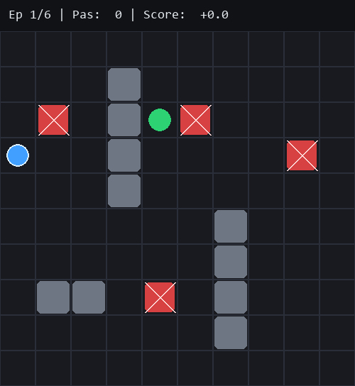
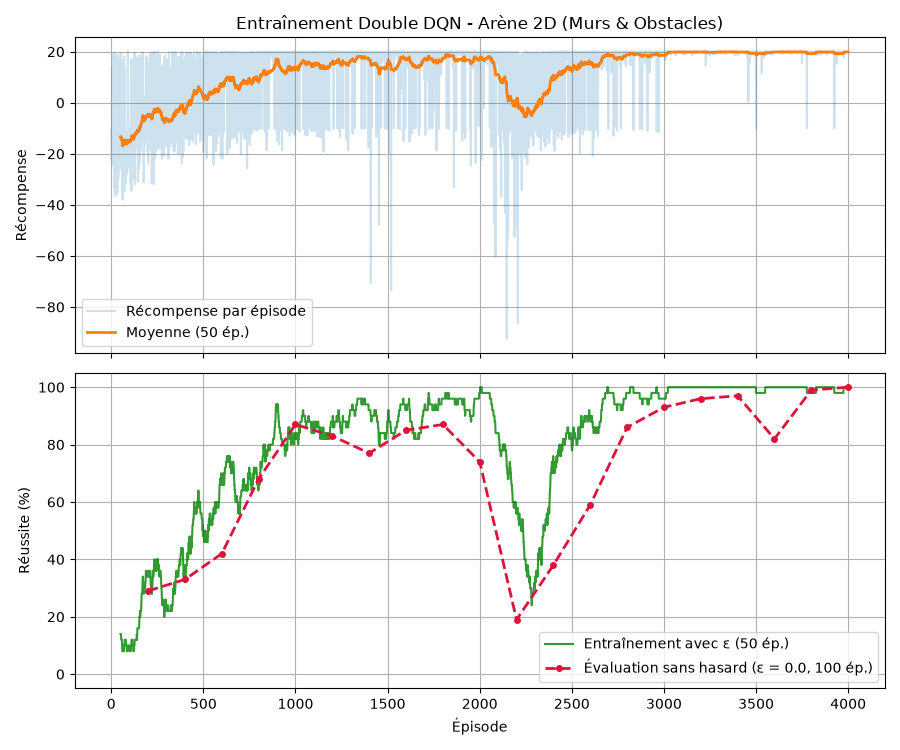

# Double DQN Navigation Agent (PyTorch & Pygame)

Implémentation modulaire **from scratch** d'un agent de Deep Reinforcement Learning (**DQN / Double DQN**) en PyTorch, validé sur une grille de référence puis déployé dans une arène 2D Pygame comportant des murs internes et des obstacles mortels.


-brightgreen)


<p align="center">
  
</p>

## Aperçu & Résultats

L'agent est évalué de manière **100 % déterministe ($\varepsilon = 0.0$)** sur des paires `(position de départ, cible)` tirées aléatoirement.

| Environnement | Architecture | Taux de réussite ($\varepsilon = 0$) | Collisions piège | Notes |
| :--- | :--- | :---: | :---: | :--- |
| **Grille $5 \times 5$** (`SimpleEnv`) | DQN + Target Network | **100,0 %** (100/100) | N/A | Politique optimale (3,89 pas en moyenne) |
| **Arène $10 \times 10$ — v1** (`TargetArenaEnv`) | DQN standard (64 neurones) | 57,0 % (114/200) | 0/200 | 86 timeouts (boucles devant les murs) |
| **Arène $10 \times 10$ — v2** (`TargetArenaEnv`) | **Double DQN (128 neurones)** | **98,5 %** (197/200) | **0/200** | 3 timeouts sur 7 310 paires possibles |

### Courbe d'entraînement — Arène 2D (Double DQN)


> *La courbe rouge pointillée suit la performance réelle sans hasard ($\varepsilon = 0.0$) mesurée tous les 200 épisodes et pilote le checkpointing du meilleur modèle (`models/dqn_arena.pth`).*

---

## Architecture du projet

Le projet découple le moteur d'apprentissage, la simulation physique et les scripts d'exécution :

- **`agent/DQNAgent.py`** : réseau Q PyTorch (`128 → 128`), mémoire de rejeu (`deque`), **Target Network** synchronisé périodiquement, mise à jour **Double DQN**, perte de Huber (`smooth_l1_loss`) et *gradient clipping*.
- **`environment/SimpleEnv.py`** : environnement de validation rapide (grille $5 \times 5$, état `[x, y]`, 5 actions).
- **`environment/TargetArenaEnv.py`** : arène Pygame $10 \times 10$ en mode *headless* (entraînement rapide sur CPU) ou rendu temps réel (HUD + affichage graphique). L'état est un vecteur de **14 capteurs normalisés** (positions agent/cible, vecteur relatif, 4 distances aux murs, 4 détecteurs de pièges adjacents).
- **`scripts/`** : scripts dédiés à l'entraînement (`train.py`, `train_arena.py`) et à l'évaluation/visualisation (`evaluate.py`, `play_arena.py`).

---

## Installation et utilisation

### 1. Prérequis
```bash
git clone [https://github.com/](https://github.com/)<ton-pseudo>/pytorch-double-dqn-arena.git
cd pytorch-double-dqn-arena
python -m venv .venv
# Windows : .venv\Scripts\activate | Mac/Linux : source .venv/bin/activate
pip install -r requirements.txt

### Enregistrer le GIF de démonstration et lancer les tests
```bash
# Générer assets/demo_arena.gif (6 épisodes déterministes)
python -m scripts.play_arena --record

# Exécuter la suite de tests unitaires
pytest -v